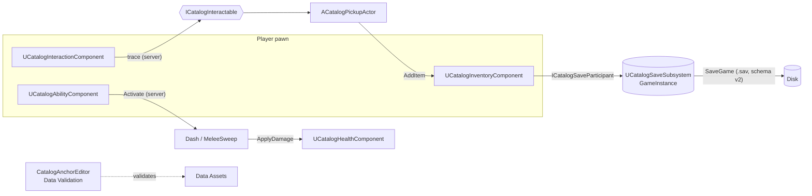

# CatalogAnchor

**English** · [Português (Brasil)](README.pt-BR.md)


**A multiplayer-ready gameplay plugin for Unreal Engine 5.8+ (C++):** hold-to-interact, replicated inventory,
cooldown abilities, health and a versioned save system. No binaries and no `.uasset` files in the repository:
the playable sample is 100% C++.

```text
Plugins/CatalogAnchor/  ->  YourProject/Plugins/   ->   Generate project files   ->   build the Editor target
```

From zero to "open a chest and save" in 10 steps (C++ and Blueprint): [docs/QUICKSTART.md](docs/QUICKSTART.md) (pt-BR).

## Features

| System | What it delivers |
|---|---|
| **Interaction** | server-side trace aimed through the camera, **hold-to-interact** with progress, "Locked" targets, focus on the local player only, anti-spam cooldown, priority-based sphere assist, `OnInteractionFailed` |
| **Inventory** | `UCatalogItemDefinition` (Data Asset), `FFastArraySerializer` list (delta, owner only), stacking, weight, `UseItem`, atomic `TransferTo`, interactable pickups |
| **Abilities** | native "GAS-lite" with Gameplay Tags, cooldown replicated on the server clock, sample Dash and Melee Sweep |
| **Health** | damage, healing, single death event, replicated to everyone; listens to `ApplyDamage` |
| **Save** | schema v2 with chained migration, sync and async, CRC32 with backup fallback, pluggable participants, slot listing |
| **Blueprint** | `UCatalogBlueprintLibrary`: save/load/list and health/inventory queries from any actor |
| **Editor** | Data Asset validators, factories, *Tools -> Catalog Anchor* menu, Project Settings |



The server decides; clients request and read replicated state. Rationale and trade-offs are recorded as ADRs in
[docs/adr/](docs/adr/README.md) (pt-BR).

## Platforms

| Platform | Status |
|---|---|
| **Windows** (UE 5.8.3, MSVC 14.44) | **Verified up to commit `876aec1`:** Editor build, Shipping build, plugin packaging, automation tests, pytest and headless multiplayer |
| **macOS** (clang) | code reviewed for clang and CI prepared; **never compiled or run** (no Mac available) |
| **Linux** (clang) | code reviewed for clang and CI prepared; **never compiled or run** (no Linux engine available) |

Prerequisites and what is still unproven: [docs/PLATFORMS.md](docs/PLATFORMS.md) (pt-BR).

## Install in 3 lines

```bash
git clone <this-repository-url> CatalogAnchor
cp -r CatalogAnchor/Plugins/CatalogAnchor YourProject/Plugins/   # then: Generate project files
# build the *Editor target and enable "Catalog Anchor (UE5)" in Edit -> Plugins
```

Step by step: [docs/INSTALACAO.md](docs/INSTALACAO.md) (pt-BR). To see it running, open `SampleProject/SampleCatalog.uproject`
(HUD, and the save menu on Tab; controls in [SampleProject/README.md](SampleProject/README.md)).
With UE 5.8+ and a C++ toolchain, one command builds and another tests: `py -3 tools/ue.py build-plugin` and `py -3 tools/ue.py test`.

## Verification status (what was actually run)

The only verified environment is **Windows with UE 5.8.3**, and only **up to commit `876aec1`**.

| Gate | Result |
|---|---|
| Editor build, Shipping build, plugin packaging | OK on UE 5.8.3, Windows (up to `876aec1`) |
| Automation (76 C++ tests in code) | 73 passed in `UnrealEditor-Cmd` up to `876aec1`; the 3 newer ones have **not been run** |
| Headless multiplayer (`tools/mp_run.py`) | dedicated server + 2 clients and listen server; real key input, HUD widget state and the locked chest (up to `876aec1`); see [docs/MULTIPLAYER_TESTS.md](docs/MULTIPLAYER_TESTS.md) (pt-BR) |
| pytest (187 cases, all passing on Windows + Python 3.14) | validator, C++ lint, `tools/ue.py`, `API.md` generator; CI on Python 3.10-3.14, Ubuntu, macOS and Windows (host-side, no engine) |
| `tools/validate_plugin.py --strict-docs` | manifests, C++ lint, every Server RPC `WithValidation`, test counts cited in the docs |
| `tools/gen_api_docs.py --check` | [docs/API.md](docs/API.md) in sync with the headers |

**Not verified:** the later changes (macOS/Linux preparation, performance work and profiling scopes, gamepad support, the
`mp_run` pickup predicate) have not been rebuilt or re-tested against the engine; macOS and Linux were never compiled; real mouse/camera, gamepad and the visual look of the
HUD were never exercised. The public CI does **not** compile C++ (GitHub runners have no Unreal Engine); `ue.yml` runs on a
self-hosted runner and has not run on a real runner yet. Details: [LIMITATIONS.md](LIMITATIONS.md) (pt-BR).

## Documentation

The technical documentation is written in **Portuguese (pt-BR)**; this README and the README.pt-BR.md mirror each other.

- [docs/QUICKSTART.md](docs/QUICKSTART.md): from zero to a chest that saves, in 10 steps
- [docs/API.md](docs/API.md): generated reference of the public headers (classes, properties, functions)
- [docs/ARQUITETURA.md](docs/ARQUITETURA.md): flow of each system, network and save decisions
- [docs/adr/](docs/adr/README.md): architecture decision records
- [docs/NETWORKING.md](docs/NETWORKING.md) · [docs/PERFORMANCE.md](docs/PERFORMANCE.md) · [docs/RELEASING.md](docs/RELEASING.md): network model and open risks, performance budget (hypotheses to measure) and release checklist
- [docs/INSTALACAO.md](docs/INSTALACAO.md) · [docs/PLATFORMS.md](docs/PLATFORMS.md) · [docs/TECNOLOGIAS.md](docs/TECNOLOGIAS.md)
- [docs/MULTIPLAYER_TESTS.md](docs/MULTIPLAYER_TESTS.md): network test script (MP-01..07)
- [CHANGELOG.md](CHANGELOG.md) · [CONTRIBUTING.md](CONTRIBUTING.md) · [LIMITATIONS.md](LIMITATIONS.md) · [SECURITY.md](SECURITY.md) · [CODE_OF_CONDUCT.md](CODE_OF_CONDUCT.md)

## License and trademarks

MIT © 2026 Geraliza Castlevania

Unreal Engine is a trademark of Epic Games, Inc.; this project is not affiliated with or endorsed by Epic Games.
