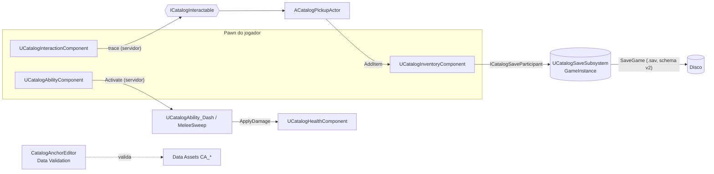

# Catalog Anchor — plugin de gameplay para Unreal Engine 5.8+


Plugin **C++ Runtime + Editor** com sistemas de gameplay reutilizáveis, **prontos para multiplayer**:
interação com hold, inventário replicado (uso, transferência, peso), habilidades com cooldown, vida com dano/cura/morte,
save versionado com migração, CRC e backup, e Data Validation no Editor. Acompanha um **sample jogável montado 100% em C++**: nenhum
`.uasset`/`.umap` no repositório.

> Repositório-âncora da seção §8 (Unreal Engine 5) do meu catálogo de portfólio: *um plugin
> reutilizável, não "um jogo feito na UE5"*. Sem binários, sem FPS inventado — ver [LIMITATIONS](LIMITATIONS.md).

## Sistemas

| Sistema | Destaques |
|---|---|
| **Interação** | trace no servidor com mira pela câmera (`GetPlayerViewPoint`) e alcance medido do pawn (`TraceChannel` configurável), **hold-to-interact** com progresso replicado ao dono, alvo bloqueado ("Trancado"), foco/highlight só para o `PlayerController` local, cooldown anti-spam, assist de esfera opcional (`bUseSphereAssist`, `GetInteractionPriority`), `OnInteractionFailed`, CVar `catalog.Interaction.Debug`, Server/Client RPCs |
| **Inventário** | `UCatalogItemDefinition` (Primary Data Asset), lista em **`FFastArraySerializer`** (delta replication, `COND_OwnerOnly`), empilhamento por `MaxStackSize`, `MaxWeight`/`Weight`, `Category` e `GetItemsByTag`, **`UseItem`** (consumo validado no servidor, `OnUsed`/`OnItemUsed`), **`TransferTo`** atômico, pickup interagível, drop por Server RPC |
| **Habilidades** | "GAS-lite" nativo: **Gameplay Tags nativas**, `UCatalogAbilityDefinition` + comportamento instanciado (Dash, Melee Sweep), cooldown replicado no relógio do servidor, cosmético por multicast |
| **Vida** | `UCatalogHealthComponent`: vida replicada para todos, escuta `ApplyDamage` (o Melee Sweep já causa dano), `Heal`, `SetHealth`, `ResetHealth`, respeita `bCanBeDamaged`, `OnDeath` único mesmo com dano reentrante, morto não ativa habilidade |
| **Save** | `UCatalogSaveSubsystem` no GameInstance, **schema v2 com migração em cadeia** (v0→v1→v2), sync e **async**, autosave, **CRC32 do payload** com fallback para backup (`<slot>_bak`, `BackupCount`), participantes plugáveis (`ICatalogSaveParticipant`) com gerações de load e substituição por chave no respawn, `ListSaveSlots`/`FCatalogSaveSlotInfo` para menu de saves, `UCatalogBlueprintLibrary`, comandos `catalog.Save.List`, `.Now`, `.Load`, `.Delete` |
| **Editor** | validadores de itens, habilidades e templates de save (nome de asset duplicado, ícone/mesh nulos, cooldown); factories na categoria "Catalog Anchor"; menu **Tools → Catalog Anchor → Validate Catalog Assets** e **Report Catalog Assets** |
| **Settings** | Project Settings → Plugins → Catalog Anchor (fonte única de todos os defaults) |



## Início rápido

**Usar no seu projeto:** copie `Plugins/CatalogAnchor/` para `SeuProjeto/Plugins/`, gere os project
files e compile o target Editor. Passo a passo em [docs/INSTALACAO.md](docs/INSTALACAO.md).

**Rodar o sample:** abra `SampleProject/SampleCatalog.uproject` (ele encontra o plugin via
`AdditionalPluginDirectories`) e aperte Play: HUD e menu de saves (Tab) em UMG feitos em C++. Controles e detalhes em
[SampleProject/README.md](SampleProject/README.md).

**Compilar e testar com um comando** (máquina com UE 5.8+ e toolchain C++; a engine vem de `--engine`, `UE_ROOT`,
registro do Windows ou `LauncherInstalled.dat` do Epic Launcher; outra versão: `--version 5.9`):

```bash
py -3 tools/ue.py build-plugin
```

```bash
py -3 tools/ue.py test
```

## Qualidade

| Gate | Onde roda | O que cobre |
|---|---|---|
| `tools/validate_plugin.py` | CI (GitHub Actions) | manifestos `.uplugin`/`.uproject`, dependências de plugin, árvore, **lint de C++** (copyright, `#pragma once`, `.generated.h` por último, TABs, BOM em fonte com acento, `_API` em tipos exportados, sem `LogTemp`), todo Server RPC com `WithValidation`/`_Validate` (`--no-strict-rpc` rebaixa a aviso) e contagens de testes citadas nos docs (`--strict-docs`) |
| pytest (140 casos) | CI: Python 3.10–3.14, Ubuntu + Windows, relatório JUnit | validador, lint e `tools/ue.py` |
| ruff | CI | estilo do Python |
| Automation (73 testes C++) | sua máquina com UE (`tools/ue.py test`) ou `ue.yml` em runner self-hosted | migração, gerações, CRC e backup de save, nomes de slot, empilhamento, uso/transferência/peso, cooldown, vida em mundo, trace e assist de interação, save do sample, validadores |

> O CI público **não** compila C++: não há Unreal Engine nos runners do GitHub. O workflow `ue.yml` compila e roda
> os testes de automação só num runner self-hosted (variável `UE_RUNNER_ENABLED=true`), que ainda não rodou num
> runner real. **Verificado manualmente (Windows, UE 5.8.3, MSVC 14.44):** build do `SampleCatalogEditor` OK e
> 64/73 testes de automação passando no `UnrealEditor-Cmd`. Ver [LIMITATIONS](LIMITATIONS.md).

## Estrutura

```
Plugins/CatalogAnchor/
  Source/CatalogAnchor/        Runtime: interação, inventário, habilidades, vida, save, settings
  Source/CatalogAnchorEditor/  Editor: validadores + menu
SampleProject/                 demo jogável 100% C++ (mapa Entry da engine)
docs/                          INSTALACAO · ARQUITETURA · TECNOLOGIAS · MULTIPLAYER_TESTS
tools/                         validate_plugin.py · ue.py · get_msvc.py · dev.py
tests/                         pytest do tooling
```

## Documentação

- [docs/INSTALACAO.md](docs/INSTALACAO.md): instalação, compilação e checklist no Editor
- [docs/ARQUITETURA.md](docs/ARQUITETURA.md): fluxo de cada sistema e as decisões de rede e save
- [docs/TECNOLOGIAS.md](docs/TECNOLOGIAS.md): stack, decisões e APIs conferidas no header 5.8.3
- [docs/MULTIPLAYER_TESTS.md](docs/MULTIPLAYER_TESTS.md): roteiro manual de testes em rede (MP-01..07)
- [CHANGELOG.md](CHANGELOG.md) · [CONTRIBUTING.md](CONTRIBUTING.md) · [LIMITATIONS.md](LIMITATIONS.md) · [SECURITY.md](SECURITY.md) · [CODE_OF_CONDUCT.md](CODE_OF_CONDUCT.md)

## Licença

MIT © 2026 Geraliza Castlevania
