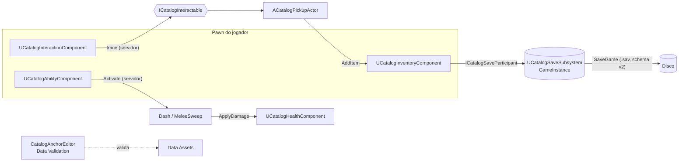

# CatalogAnchor

**Português (Brasil)** · [English](README.md)


**Plugin C++ de gameplay para Unreal Engine 5.8+, pronto para multiplayer:** interação com hold, inventário replicado,
habilidades com cooldown, vida e save versionado. Sem binários e sem `.uasset` no repositório: o sample jogável é 100% C++.

```text
Plugins/CatalogAnchor/  ->  SeuProjeto/Plugins/   ->   Generate project files   ->   compile o target Editor
```

Do zero a "abrir um baú e salvar" em 10 passos (C++ e Blueprint): [docs/QUICKSTART.md](docs/QUICKSTART.md).

## Recursos

| Sistema | O que entrega |
|---|---|
| **Interação** | trace no servidor com mira pela câmera, **hold-to-interact** com progresso, alvo "Trancado", foco só no jogador local, cooldown anti-spam, assist de esfera por prioridade, `OnInteractionFailed` |
| **Inventário** | `UCatalogItemDefinition` (Data Asset), lista em `FFastArraySerializer` (delta, só dono), empilhamento, peso, `UseItem`, `TransferTo` atômico, pickup interagível |
| **Habilidades** | "GAS-lite" nativo com Gameplay Tags, cooldown replicado no relógio do servidor, Dash e Melee Sweep de exemplo |
| **Vida** | dano, cura, morte única, replicada para todos; escuta `ApplyDamage` |
| **Save** | schema v2 com migração em cadeia, sync e async, CRC32 com fallback para backup, participantes plugáveis, lista de slots |
| **Blueprint** | `UCatalogBlueprintLibrary`: save/load/lista e consultas de vida e inventário a partir de qualquer ator |
| **Editor** | validadores de Data Assets, factories, menu *Tools -> Catalog Anchor*, Project Settings |



## Plataformas

| Plataforma | Estado |
|---|---|
| **Windows** (UE 5.8.3, MSVC 14.44) | **Verificado até o commit `876aec1`:** build Editor, build Shipping e empacotamento OK; testes de automação, pytest e multiplayer rodados. As mudanças posteriores (preparo Mac/Linux, otimizações, gamepad) **ainda não foram verificadas** |
| **macOS** (clang) | código revisado para clang e CI preparado; **não executado** (sem Mac nesta máquina) |
| **Linux** (clang) | código revisado para clang e CI preparado; **não executado** (sem engine Linux nesta máquina) |

Detalhes, pré-requisitos e o que falta provar: [docs/PLATFORMS.md](docs/PLATFORMS.md).

## Instalação

```bash
git clone <url-deste-repositório> CatalogAnchor
```

Copie `Plugins/CatalogAnchor/` para `SeuProjeto/Plugins/`, gere os project files e compile o target `*Editor`.
Passo a passo: [docs/INSTALACAO.md](docs/INSTALACAO.md). Para ver rodando, abra `SampleProject/SampleCatalog.uproject`
(HUD e menu de saves em Tab; controles em [SampleProject/README.md](SampleProject/README.md)).

Compilar e testar com um comando (máquina com UE 5.8+ e toolchain C++): `py -3 tools/ue.py build-plugin` e `py -3 tools/ue.py test`.

## Verificação (o que foi realmente executado)

| Gate | Resultado |
|---|---|
| Build Editor + Shipping + empacotamento | OK na UE 5.8.3, Windows |
| Automation (76 testes C++ no código) | 73 passaram no `UnrealEditor-Cmd` até `876aec1`; os 3 mais novos ainda não foram executados (migração, CRC e backup de save, empilhamento, uso/transferência/peso, cooldown, vida, trace e assist, validadores) |
| pytest (185 casos) | validador, lint de C++, `tools/ue.py`, gerador de `API.md`; CI em Python 3.10-3.14, Ubuntu + Windows (roda no host, sem engine) |
| Multiplayer headless (`tools/mp_run.py`) | servidor dedicado + 2 clientes e listen server; teclas reais, HUD (estado dos widgets) e baú trancado; ver [docs/MULTIPLAYER_TESTS.md](docs/MULTIPLAYER_TESTS.md) |
| `tools/validate_plugin.py` | manifestos, lint de C++, todo Server RPC com `WithValidation` e contagens de testes dos docs (`--strict-docs`) |
| `tools/gen_api_docs.py --check` | [docs/API.md](docs/API.md) em dia com os headers |

Tudo acima vale até o commit `876aec1`; o que veio depois (preparo para Mac/Linux, otimizações, gamepad) **não foi reverificado** com a engine.
O CI público **não** compila C++ (não há Unreal Engine nos runners do GitHub); o `ue.yml` roda em runner self-hosted.
Mac/Linux, mouse e câmera reais, gamepad e a aparência visual do HUD **não** foram verificados: ver [LIMITATIONS.md](LIMITATIONS.md).

## Documentação

> A documentação técnica está em **português (pt-BR)**; o [README.md](README.md) (inglês) é a vitrine do projeto.

- [docs/QUICKSTART.md](docs/QUICKSTART.md): do zero a um baú que salva, em 10 passos
- [docs/API.md](docs/API.md): referência gerada dos headers públicos (classes, propriedades, funções)
- [docs/ARQUITETURA.md](docs/ARQUITETURA.md): fluxo de cada sistema e decisões de rede e save
- [docs/INSTALACAO.md](docs/INSTALACAO.md) · [docs/PLATFORMS.md](docs/PLATFORMS.md) · [docs/TECNOLOGIAS.md](docs/TECNOLOGIAS.md)
- [docs/MULTIPLAYER_TESTS.md](docs/MULTIPLAYER_TESTS.md): roteiro de testes em rede (MP-01..07)
- [docs/adr/](docs/adr/README.md): decisões de arquitetura (servidor autoritativo, FastArray, regra de delta do save, CRC e backups...)
- [docs/NETWORKING.md](docs/NETWORKING.md) · [docs/PERFORMANCE.md](docs/PERFORMANCE.md) · [docs/RELEASING.md](docs/RELEASING.md): modelo de rede e riscos, orçamento de performance (hipóteses a medir) e checklist de release
- [CHANGELOG.md](CHANGELOG.md) · [CONTRIBUTING.md](CONTRIBUTING.md) · [LIMITATIONS.md](LIMITATIONS.md) · [SECURITY.md](SECURITY.md) · [CODE_OF_CONDUCT.md](CODE_OF_CONDUCT.md)

## Licença e marcas

MIT © 2026 Geraliza Castlevania

Unreal Engine é marca registrada da Epic Games, Inc.; este projeto não é afiliado nem endossado pela Epic Games.
